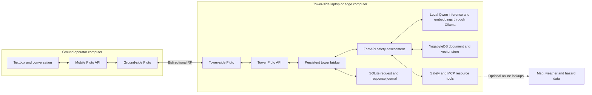

# EDGE-RESQ

### AI-Native Wireless Edge Intelligence for Disaster Management

EDGE-RESQ connects a ground person to a local disaster-response intelligence system through  ADALM-Pluto software-defined radios. The person describes a situation in a simple web interface, the tower-side computer assesses it using local AI and emergency knowledge, and the response returns over the same wireless link.

The prototype uses **one ground operator, one bidirectional radio link and one edge server**. It brings together wireless communication, local inference, retrieval-augmented generation (RAG), YugabyteDB and emergency-resource tools in a single workflow.

## Problem statement

This is a specific problem statement we are targeting for
EdgeAI and IoT connectivity as a roadmap for 6g.

Disaster response needs a way to exchange field reports and operational guidance when ordinary communication infrastructure is unavailable or unreliable. Field observations also need to be interpreted alongside emergency procedures and relevant resource information.

EDGE-RESQ addresses this problem with a direct ground-to-tower radio connection and a local intelligence stack. Its goal is to help an operator report incidents, retrieve relevant procedures and review proposed next steps without depending on a hosted AI service.

## What the system does

- Sends field messages and receives responses through paired Pluto SDRs.
- Provides a mobile-friendly interface with one textbox and a conversation view.
- Assesses messages through the tower backend's `POST /safety/assess` endpoint.
- Classifies supported incidents and returns provisional danger labels.
- Retrieves relevant passages from ingested emergency manuals and SOPs.
- Returns cited recommendations when report evidence is available.
- Provides explicitly labeled built-in guidance when model or report-based assessment is unavailable.
- Uses supplied locations to look up nearby safe places and emergency-service locations.
- Preserves tower requests and pending responses across restarts.
- Keeps recommendations separate from approval and dispatch: returned actions are proposals for human review.

## Architecture



The browser communicates **only with its local mobile Pluto API**. It does not connect directly to the tower backend, database, Ollama or MCP services.

The tower-side laptop hosts the AI, database, application backend and MCP service. The SDR processes run on their respective computers so they can access the attached hardware directly.

### Request lifecycle

1. The operator enters a message in the host UI.
2. The UI submits a JSON text object to the mobile Pluto API.
3. The existing transport serializes, optionally compresses/encrypts, fragments and transmits the message.
4. The peer transport reconstructs and validates the message, then places it in the tower inbox.
5. The tower bridge persists the received request and sends an application acknowledgement back over RF.
6. The bridge forwards the message to `POST /safety/assess` on the tower backend.
7. The backend runs incident assessment, retrieves available knowledge and performs location-aware resource lookups when a location is supplied.
8. The bridge journals the response and transmits it through the tower Pluto.
9. The host UI displays the returned assessment, guidance and available resource information.

A **radio delivery ACK** confirms receipt by the peer transport. A **tower acknowledgement** confirms application acceptance. Neither means that an action has been approved or a resource dispatched.

## Technology stack

| Component | Implementation |
| --- | --- |
| Ground interface | Vanilla HTML, CSS and JavaScript; no frontend framework |
| Wireless hardware | Two ADALM-Pluto SDRs |
| SDR integration | Python, libiio and pyadi-iio |
| Radio transport | Existing 2-FSK implementation, JSON framing, fragmentation, CRC-32, ACKs and retries |
| Application APIs | FastAPI and Pydantic |
| Local inference | Configurable Qwen model served through Ollama |
| Embeddings | `nomic-embed-text`, with 768-dimensional vectors |
| Knowledge storage | YugabyteDB YSQL with pgvector |
| Retrieval | Cosine-distance search over document chunks |
| Resource tools | Python MCP SDK and shared safety-tool functions |
| Request persistence | SQLite journal and response outbox on the tower |
| Tower deployment | Docker Compose |

The safety API calls the resource-tool functions directly. The same implementations are also exposed by the standalone MCP server.

## Quick start

Copy the project onto both computers and attach one Pluto to each. Run the following commands from the project root.

**Ground computer / host:**

```bash
./start.sh host
```

**Tower computer / server:**

```bash
./start.sh server
```

The host starts its radio, API and operator interface. The server additionally starts YugabyteDB, Ollama, the tower FastAPI application, MCP and the tower bridge.

The launcher prepares a private Python environment, installs missing dependencies, checks the native SDR driver, selects the local device and opens the local interface. On macOS, missing native-driver build dependencies can be installed through Homebrew. Complete any required first-time Homebrew, Apple Command Line Tools or Docker Desktop setup when prompted.

Missing configured models download in the background. Until model services are ready, assessments may use the backend's explicitly labeled built-in fallback. To wait for model readiness before starting the server radio:

```bash
./start.sh server --wait-for-models
```

If executable permissions were lost while copying files, use `bash start.sh host` or `bash start.sh server`.

### Hardware and software prerequisites

- Two ADALM-Pluto SDRs with suitable antennas and USB connections.
- A ground computer and a tower computer; the automatic setup workflow targets macOS.
- Python 3.9–3.13; the launcher prefers Python 3.12.
- A compatible native libiio runtime, reused or prepared by the launcher.
- Docker Desktop on the tower computer, with sufficient resources for the selected model and database.
- Internet access for initial dependency/model downloads and optional live resource lookups.

Use compatible RF and transport settings on both peers. Frequency, transmit power and antenna configuration must be appropriate for the deployment environment.

### Device selection

With one USB Pluto attached, the launcher detects the local device. When selection is ambiguous, specify a serial or local device URI:

```bash
./start.sh host --serial YOUR_GROUND_PLUTO_SERIAL
./start.sh server --serial YOUR_TOWER_PLUTO_SERIAL

# Alternative: a Pluto reachable through its local network interface
./start.sh host --uri ip:192.168.2.1
```

The selected URI identifies the Pluto reachable from that computer, not the other computer's application API.

### Stop an instance

Press **Ctrl+C** in its terminal, or run:

```bash
./start.sh host --stop
./start.sh server --stop
```

Docker services and named data/model volumes are retained for subsequent launches. To stop the tower containers without deleting their data:

```bash
docker compose stop
```

Detailed startup and troubleshooting instructions are in [STARTUP.md](STARTUP.md).

## Operator interface

Open the host URL printed by the launcher. Enter what is happening, relevant observations and the assistance needed, then select **Send message**.

A location is optional. For nearby resource lookups, include a location line in the same textbox:

```text
Describe the incident and the help needed.
Location: town, landmark or address
```

Coordinates are also supported:

```text
Describe the incident and the help needed.
Location: 28.6, 77.2
```

The UI accepts up to **2,000 characters**. Responses can include classification, provisional danger, ordered guidance, cautions, source references and nearby locations. Full response JSON is available under **Response details**.

Keep **one receive consumer per endpoint**. Opening the host conversation in multiple browsers, or using its JSON console at the same time, divides incoming messages between consumers. The server interface reserves its inbox for the tower bridge.

See [frontend and bridge documentation](transport_stack/FRONTEND.md) for payloads, correlation and error handling.

## Local AI and emergency knowledge

### Assessment

All operator messages follow the same application route:

```http
POST /safety/assess
Content-Type: application/json
```

```json
{
  "text": "Describe the situation and assistance needed."
}
```

For tower-side API clients, the request also supports `place_name`, or a `latitude`/`longitude` pair, plus optional assessment parameters. The bridge translates an explicit `Location:` line into the corresponding location fields.

Text-only assessments return available guidance without inventing coordinates or nearby resources. When location is missing, the response includes `location_required` and a location prompt. Location-aware requests use the existing safety-plan workflow.

Supported incident categories include fire, earthquake/building collapse, flood, cyclone, glacial lake outburst and drought. `unknown` indicates insufficient classification evidence; it does not establish that a situation is safe. Danger labels are provisional type-based priorities rather than measured field severity.

### RAG pipeline

```text
Emergency manuals / SOP PDFs
    → text extraction and cleaning
    → overlapping text chunks
    → local document embeddings
    → YugabyteDB vector storage

Operator message
    → local query embeddings
    → cosine-similarity retrieval
    → relevant document passages
    → local assessment and guidance selection
    → response with source references
```

The current defaults use **800-character chunks**, **120-character overlap**, **768-dimensional embeddings** and **top-5 retrieval**. These are implementation settings, not token counts.

Upload actual emergency manuals through the tower API:

```bash
curl -sS -X POST http://127.0.0.1:8000/rag/documents \
  -F "file=@/path/to/emergency-manual.pdf"
```

The API creates the configured database and applies the document schema on initialization. Stored chunks include source metadata for filenames, pages and chunk positions. Scanned image-only PDFs require OCR before ingestion.

An empty document store cannot produce report-grounded recommendations. The backend exposes grounding status and may return built-in procedures instead. Citation validation checks provenance; it does not guarantee that advice is applicable or that a classification is correct.

### Storage responsibilities

| Store | Current responsibility |
| --- | --- |
| YugabyteDB `documents` table | Emergency-document chunks, metadata and `vector(768)` embeddings |
| Tower SQLite journal | Received requests, assigned incident references, processing state and pending responses |
| Browser memory | Current conversation and received assessments |
| Browser session storage | Current unsent textbox draft, when storage is available |

A browser reload does not reconstruct previously consumed replies. The tower journal independently preserves interrupted work and unsent results.

## Resource tools and connectivity

The local MCP service exposes:

- `geocode_place`
- `get_emergency_numbers`
- `find_safe_locations`
- `check_nearby_hazards`
- `calm_safety_plan`

The current tools use OpenStreetMap/Nominatim/Overpass, Open-Meteo and USGS for location, map, weather, elevation and hazard information. Resource results can include hospitals, clinics, shelters, assembly points, police stations, fire stations and other mapped safe places.

**Local model inference, document retrieval and built-in guidance do not require a hosted AI API. Live map, weather and hazard lookups require internet access.** Running the MCP process locally does not make those external data sources offline. Model weights and dependencies must also be downloaded before offline use.

Mapped locations are not verified resource availability. Hospital capacity, ambulance availability, excavator registries and dispatch/assignment workflows are not implemented in the current prototype.

## APIs and ports

The following ports reflect the supplied transport and Compose configuration. The startup log is authoritative when ports are changed.

| Service | Address / port |
| --- | --- |
| Host interface and mobile Pluto API | `http://127.0.0.1:12000` |
| Server Pluto API | `http://127.0.0.1:12001` |
| Tower application API | `http://127.0.0.1:8000` |
| Tower API documentation | `http://127.0.0.1:8000/docs` |
| MCP service | `http://127.0.0.1:8001/mcp` |
| YugabyteDB YSQL | `5433` |
| YugabyteDB management UI | `7001` |
| Ollama | `11434` |

The Pluto APIs bind to loopback by default. Access from a separate phone requires an explicitly configured reachable mobile API origin or same-origin proxy.

### Pluto transport API

| Method | Endpoint | Purpose |
| --- | --- | --- |
| `GET` | `/health` | Local transport state, settings and counters |
| `POST` | `/send` | Submit a JSON object for transmission |
| `GET` | `/receive?timeout_ms=15000` | Consume one received message through long polling |
| `GET` / `POST` | `/session` | Inspect or establish an optional transport session |

`/send` returns transport references, fragment/retry counts and measured latency. HTTP 504 means delivery is uncertain: the peer may have received the message even though the ACK was lost. The UI preserves uncertain input and does not automatically repeat its POST.

### Tower application API

These endpoints are called on the tower side; they are not direct browser connections in the radio workflow.

| Method | Endpoint | Purpose |
| --- | --- | --- |
| `POST` | `/safety/assess` | Text assessment and optional location-aware safety plan |
| `POST` | `/safety/geocode` | Resolve a supplied place name |
| `POST` | `/safety/places` | Find nearby safe locations |
| `POST` | `/safety/hazards` | Retrieve nearby hazard context |
| `GET` | `/safety/emergency-numbers/{country_code}` | Retrieve configured emergency contacts |
| `POST` | `/rag/documents` | Ingest a PDF |
| `POST` | `/rag/query` | Query ingested emergency documents |
| `GET` | `/rag/health` | Check database, models and embedding dimensions |
| `POST` | `/classification/classify` | Run the existing standalone classification workflow |

## Wireless configuration

Settings live in [transport.yaml](transport_stack/configs/transport.yaml). The launcher generates local runtime configurations without rewriting that shared file.

| Parameter | Current implementation |
| --- | --- |
| Link | Two-node, bidirectional point-to-point radio |
| Modulation | 2-FSK |
| Center frequency in supplied configuration | 866.5 MHz |
| Sample rate | 2 MS/s |
| Samples per symbol | 8 in the supplied configuration |
| Payload | JSON, encoded once before fragmentation |
| Integrity | CRC-32 |
| Reliability | Delivery ACKs and bounded fragment retries |
| Compression | Zstandard in the launcher's reliable profile; other configured algorithms are supported |
| Encryption and signatures | Optional AES-256-GCM, X25519 key agreement and Ed25519 signing through existing transport settings |

The default **reliable** hardware profile uses 128-byte packets, a one-packet window, at least a 500 ms ACK wait, 32,768 receive-buffer samples and four RX kernel buffers. It enables ACKs and selects Zstandard when compression was disabled. `--transport-profile configured` uses the original configured packet/window/buffer settings instead.

The fast configuration does **not** enable encryption or signatures by default. Secure operation requires configuring the existing security options and provisioning matching keys on both peers. CRC detects transmission errors; it does not authenticate a sender.

For framing, security, simulation and transport details, see [TRANSPORT.md](transport_stack/TRANSPORT.md) and [the packet reference](transport_stack/CURRENT_DATA_PACKET.md).

## Configuration

Model and application settings are supplied through `.env`; see [.env.example](.env.example). Radio settings are separate in `transport_stack/configs/transport.yaml`.

| Setting | Purpose |
| --- | --- |
| `OLLAMA_CHAT_MODEL` | Selected local generation model; for example, `qwen3:8b` |
| `OLLAMA_EMBED_MODEL` | Embedding model; default `nomic-embed-text` |
| `VECTOR_DIMENSION` | Must match embedding output and the database column; currently 768 |
| `OLLAMA_NUM_CTX` | Model context budget |
| `OLLAMA_TEMPERATURE` | Generation temperature |
| `TOP_K` | Default retrieval count |
| `CHUNK_SIZE` / `CHUNK_OVERLAP` | Document chunk sizes in characters |
| `MIN_SIMILARITY` | Optional retrieval similarity threshold |
| `DATABASE_URL` | YSQL connection string; Compose supplies the container address |
| `OLLAMA_BASE_URL` | Ollama service address; Compose supplies its internal address |

The generation model is configurable rather than fixed to one model size. The example configuration uses `qwen2.5:3b`; deployment-specific `.env` settings take precedence. Changing the embedding model requires updating the vector dimension/schema together and re-embedding documents.

## Project structure

```text
EDGE-RESQ/
├── README.md
├── STARTUP.md                     # Detailed two-device setup and troubleshooting
├── start.sh                       # One-command host/server entry point
├── docker-compose.yml             # Tower application services
├── Dockerfile
├── .env.example
├── scripts/
│   ├── launch.py                  # Setup, device selection and supervision
│   ├── server_infra.py            # Docker services and model preparation
│   └── tower_bridge.py            # Radio inbox → safety assessment → radio response
├── transport_stack/
│   ├── run.py                     # Existing transport entry point
│   ├── configs/                   # Radio, transport and security settings
│   ├── json_transport/
│   │   ├── api.py                 # Pluto HTTP interface
│   │   ├── engine.py              # Fragmentation, reassembly and reliability
│   │   ├── radio.py               # Persistent hardware radio adapter
│   │   └── frontend/              # Vanilla textbox/conversation UI
│   ├── pluto_json_radio/           # Existing radio, PHY and security utilities
│   ├── tests/
│   └── tools/
├── edge-resq-app/
│   ├── main.py                    # Tower FastAPI application
│   ├── classification_agent.py    # Incident interpretation and guidance selection
│   ├── schemas.py
│   ├── routes/                    # Safety, classification and RAG APIs
│   ├── rag/                       # PDF ingestion, embeddings, retrieval and playbooks
│   ├── models/                    # Database and Ollama integration
│   ├── mcp_tools.py               # Shared safety tools and MCP server
│   ├── db/schema.sql              # Document/vector schema
│   └── tests/
└── tests/                         # Additional backend and pipeline tests
```

Generated environments, device preferences and the tower journal live under the Git-ignored `transport_stack/.runtime/` directory. Do not copy that directory between computers.

## Testing and evaluation

After launcher setup, run the transport, launcher and bridge tests from the project root:

```bash
PYTHONPATH=transport_stack transport_stack/.runtime/venv/bin/python \
  -m pytest transport_stack/tests -q

node --test transport_stack/tests/frontend.test.mjs
```

In a backend Python environment with its requirements and pytest installed:

```bash
python -m pytest edge-resq-app/tests/test_safety.py -q
```

Hardware-free end-to-end transport uses two terminals on **one computer**:

```bash
./start.sh host --simulate
./start.sh server --simulate
```

The server still starts its real backend and bridge. Simulation uses loopback UDP and does not connect separate computers or initialize an SDR. For a transport-only diagnostic, add `--radio-only` to the server command.

For hardware evaluation, measure radio delivery/ACK latency separately from model inference, retrieval, resource lookup and complete ground-to-tower-to-ground response time. The API exposes fragment retries, counters, queue wait and confirmed send latency. RSSI, SNR and BER are not exposed by the transport health endpoint; separate radio feature utilities are available. No fixed range, throughput or end-to-end latency guarantee is claimed.

## Prototype scope and roadmap

| Available in this prototype | Future development |
| --- | --- |
| One operator and one paired SDR link | Multiple operators and independent field/IoT nodes |
| Local assessment and document retrieval | Broader incident lifecycle and conversation-history APIs |
| Document vectors in YugabyteDB | Dedicated incident, resource and assignment tables |
| Mapped safe-place/resource discovery | Verified offline resource registries and capacity/availability feeds |
| Proposed operational guidance | Auditable human-approval and dispatch workflows |
| Fixed, configurable radio settings | Intelligent network control and traffic prioritization |
| Single tower-side edge deployment | Multi-tower coordination and distributed edge services |

The current assessment workflow composes classification, retrieval and resource tools in Python. It does not implement four independent agent services, network slicing, semantic communication or a 6G network stack.

EDGE-RESQ is a disaster-response decision-support prototype. Its outputs require human review; it does not automatically authorize rescue actions or dispatch emergency resources.
